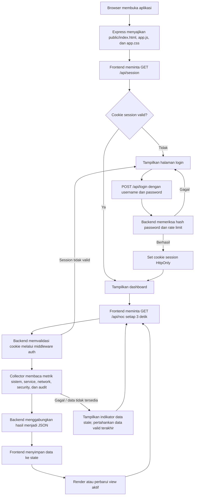

# Project-Noc

Project-Noc adalah dashboard operasional dan keamanan (SOC / NOC) yang berjalan di server lokal untuk memantau kondisi infrastruktur, layanan sistem, lalu lintas jaringan, dan kejadian keamanan. Aplikasi ini dibuat dengan Node.js + Express dan menampilkan data secara real-time dari sistem operasi seperti `systemctl`, `ss`, `journalctl`, `df`, dan `netstat`-style command yang umum tersedia di Linux.

## Fitur utama

- Monitoring sistem: CPU load, memori, penggunaan disk, uptime, dan kernel
- Status layanan: `systemctl is-active` untuk layanan seperti nginx, MySQL, PHP-FPM, ZeroTier, Wazuh, dan layanan internal
- Pemeriksaan HTTP/TCP: mengecek endpoint penting dan port terbuka
- Keamanan: event SSH seperti login berhasil, gagal, invalid user, dan brute-force attempt
- Firewall & keamanan jaringan: UFW block history, koneksi jaringan, listener socket, serta peer ZeroTier
- Audit logs: event service starts/stops, sudo activity, dan event sshd
- Dashboard antarmuka web: tampilan overview, infrastructure, security events, network, processes, audit
- Autentikasi: login password dengan rate limiting 5 percobaan per 5 menit

## Arsitektur aplikasi

```text
Project-Noc/
├── data/
│   ├── metrics.json                 # Telemetry untuk grafik; dibuat/diperbarui aplikasi
│   ├── users.json                   # User, hash password, dan secret TOTP
│   └── INITIAL_CREDENTIALS.txt      # Kredensial bootstrap; dibuat saat pertama dijalankan
├── docs/
│   └── screenshots/                 # Screenshot dokumentasi dashboard
├── public/
│   ├── app.css                      # Styling dashboard
│   ├── app.js                       # Pengambilan data, state, navigasi, dan rendering UI
│   └── index.html                   # Struktur halaman dan shell dashboard
├── .gitignore
├── LICENSE
├── package.json
├── README.md
└── server.js                        # Backend Express, autentikasi, collector, dan API
```

Folder `data/` menyimpan data runtime. `users.json` dan `INITIAL_CREDENTIALS.txt` dapat berisi informasi sensitif; jangan unggah data produksi ke repository publik. Folder `docs/screenshots/` disediakan untuk gambar dokumentasi yang aman dibagikan.

## Screenshot

Screenshot antarmuka disimpan di `docs/screenshots/`. Galeri berikut disusun dari ringkasan umum ke halaman operasional yang lebih spesifik:

<table>
  <tr>
    <td width="50%">
      
      <p><strong>Overview</strong><br>Ringkasan kesehatan host, metrik sistem, layanan, dan aktivitas keamanan.</p>
    </td>
    <td width="50%">
      
      <p><strong>Infrastructure</strong><br>Tren resource, penggunaan filesystem, traffic interface, dan status layanan.</p>
    </td>
  </tr>
  <tr>
    <td width="50%">
      
      <p><strong>Aplikasi dan layanan</strong><br>Cuplikan status unit layanan yang dipantau di bagian Infrastructure.</p>
    </td>
    <td width="50%">
      
      <p><strong>Security Events</strong><br>Ringkasan event SSH, distribusi severity, dan status agent Wazuh.</p>
    </td>
  </tr>
  <tr>
    <td width="50%">
      
      <p><strong>Network &amp; Zero Trust</strong><br>Topologi ZeroTier, peer, dan socket listener berdasarkan exposure.</p>
    </td>
    <td width="50%">
      
      <p><strong>Processes &amp; Connections</strong><br>Daftar koneksi TCP/UDP beserta state, alamat lokal/remote, dan proses.</p>
    </td>
  </tr>
  <tr>
    <td width="50%">
      
      <p><strong>Threat Map</strong><br>Peta sumber event keamanan dan ringkasan threat-intelligence yang tampak pada screenshot.</p>
    </td>
    <td width="50%">
      
      <p><strong>Audit Logs</strong><br>Aktivitas sudo, perubahan layanan systemd, dan siklus hidup sshd.</p>
    </td>
  </tr>
</table>

> **Privasi:** beberapa screenshot memperlihatkan hostname/domain, alamat IP, username, serta isi audit log. Samarkan informasi tersebut sebelum mempublikasikan repository atau membagikan gambar ke pihak lain. Jangan sertakan password, token, atau secret.

> **Kesesuaian versi:** screenshot mendokumentasikan tampilan yang ada pada gambar. Contohnya, screenshot Threat Map memperlihatkan halaman yang tidak tercantum di daftar view pada frontend repository saat ini; pastikan implementasi dan screenshot sudah sesuai sebelum menganggap semua halaman tersedia pada versi kode ini.

## Alur backend dan tampilan

Diagram berikut merangkum jalur utama data dari browser ke server dan kembali ke komponen dashboard:



Rincian proses:

1. Express menyajikan file statis dari `public/`.
2. Saat inisialisasi, frontend memeriksa session melalui `GET /api/session`. Jika belum terautentikasi, halaman login ditampilkan.
3. Login frontend mengirim username dan password ke `POST /api/login`. Jika valid, backend mengirim cookie session. Percobaan gagal dibatasi menjadi 5 kali sebelum IP dikunci selama 5 menit.
4. Setelah login, frontend memanggil `GET /api/noc` segera, lalu mengulang permintaan setiap 3 detik. Endpoint ini dilindungi middleware autentikasi.
5. Backend mengumpulkan data dari sistem operasi dan layanan yang dikonfigurasi, membaca telemetry historis, menghitung status kesehatan, lalu mengirim satu respons JSON.
6. Frontend menyimpan respons tersebut di state, memperbarui indikator header, lalu memilih renderer sesuai view aktif: Overview, Infrastructure, Security Events, Network, Processes, atau Audit.
7. Jika pengambilan data gagal, dashboard mempertahankan data valid terakhir dan menampilkan indikator bahwa feed sedang stale. Jika server membalas `401`, frontend kembali ke halaman login.

> Catatan implementasi: backend menyediakan endpoint `POST /api/2fa/verify`, tetapi alur login pada frontend saat ini hanya memanggil `POST /api/login`; UI belum meminta atau mengirim kode TOTP.

## Persyaratan

- Node.js LTS (direkomendasikan v18 atau lebih tinggi)
- Sistem Linux yang memiliki command berikut:
  - `systemctl`
  - `curl`
  - `ss`
  - `journalctl`
  - `df`
  - `nproc`
  - `uname`
  - `cat /proc/...`
- Akses root atau minimal akses ke service dan log sistem yang ingin dimonitor

## Cara install

1. Clone repository:

   ```bash
   git clone https://github.com/muathoillah/Project-Noc.git
   cd Project-Noc
   ```

2. Install dependency:

   ```bash
   npm install
   ```

3. Jalankan aplikasi:

   ```bash
   node server.js
   ```

4. Aplikasi akan berjalan di:

   ```text
   http://127.0.0.1:4000
   ```

## Konfigurasi lingkungan

Aplikasi mendukung variabel environment berikut:

```bash
export PORT=4000
export NOC_USER=admin
export NOC_PASSWORD=StrongPassword123
export NOC_SESSION_KEY=custom-session-key
node server.js
```

Catatan:
- Jika `NOC_USER` dan `NOC_PASSWORD` tidak di-set, aplikasi akan membuat user admin secara otomatis dengan password acak.
- Password awal akan dicetak ke terminal dan disimpan di `data/INITIAL_CREDENTIALS.txt`.
- `NOC_SESSION_KEY` digunakan untuk menandatangani session cookie.

## Login dan autentikasi

Saat pertama kali dijalankan, aplikasi akan membuat user admin dan TOTP secret baru jika belum ada user. Informasi bootstrap ditulis ke terminal dan file `data/INITIAL_CREDENTIALS.txt`.

Contoh isi kredensial:

```text
SOC / NOC Dashboard - initial credentials
URL      : https://noc.muthisyah.my.id
Username : admin
Password : <password-acak>
Secret   : <totp-secret>
```

Pada alur UI saat ini, login dilakukan dengan username dan password. Backend juga memiliki endpoint verifikasi TOTP, tetapi belum terhubung ke form login frontend. Aplikasi menerapkan rate limiting:

- Maksimal 5 percobaan login per IP
- Lockout selama 5 menit jika melebihi batas

## Endpoint API utama

Semua endpoint API utama memerlukan autentikasi cookie session kecuali endpoint login.

### `GET /api/session`
Mengembalikan status autentikasi session saat ini.

### `POST /api/login`
Login awal dengan username dan password.

Request body:

```json
{
  "username": "admin",
  "password": "password-anda"
}
```

### `POST /api/2fa/verify`
Endpoint backend untuk verifikasi kode TOTP. Endpoint ini tersedia di server, tetapi belum dipanggil oleh UI saat ini.

Request body:

```json
{
  "username": "admin",
  "password": "password-anda",
  "code": "123456"
}
```

### `POST /api/logout`
Logout pengguna aktif.

### `GET /api/noc`
Mengambil payload dashboard yang berisi:

- `system`
- `disk`
- `net`
- `services`
- `security`
- `network`
- `processes`
- `audit`
- `metrics`
- `health`

## Struktur data

### `data/users.json`
Berisi user terdaftar, hash password, salt, secret TOTP, dan flag `totpVerified`.

### `data/metrics.json`
Menampung serial metric historis seperti:

```json
[
  {
    "ts": 1730000000000,
    "load1": 0.82,
    "memUsedPct": 48,
    "diskUsedPct": 35,
    "rx": 1.6,
    "tx": 0.9
  }
]
```

### `data/INITIAL_CREDENTIALS.txt`
File ini berisi kredensial awal yang dibuat otomatis ketika user belum ada. Biasanya dipakai sebagai backup saat bootstrapping server tanpa akses interaktif.

## Fitur dashboard

### Overview
Menampilkan ringkasan kesehatan, uptime, status server, dan indikator kondisi sistem.

### Infrastructure
Menampilkan:
- status CPU, RAM, swap
- penggunaan disk per mount point
- service health
- HTTP/TCP probing

### Security Events
Menampilkan log SSH dan indikator keamanan seperti:
- accepted login
- failed password
- invalid user
- max authentication attempts

### Network & Zero Trust
Menampilkan:
- traffic interface network
- state peer ZeroTier
- listener TCP/UDP
- informasi jaringan dan peer

### Processes & Connections
Menampilkan daftar koneksi aktif, port yang dibuka, serta mapping user/process ke socket.

### Audit Logs
Menampilkan log dari:
- `sudo`
- `systemd`
- `sshd`

## Catatan keamanan

- Aplikasi berjalan secara lokal pada `127.0.0.1` dan tidak mengikat ke semua interface secara default.
- Session cookie menggunakan `HttpOnly`, `Secure`, dan `SameSite=Strict`.
- Password disimpan dalam bentuk hash `scrypt` dengan salt unik per user.
- TOTP secret disimpan di file `data/users.json` dan sebaiknya diproteksi dengan permission `0600`.
- Jangan commit file `data/users.json` atau `data/INITIAL_CREDENTIALS.txt` ke repo publik jika itu berisi credential produksi.

## Troubleshooting

### App tidak bisa login
- Pastikan `users.json` ada di folder `data/`
- Cek apakah `INITIAL_CREDENTIALS.txt` berisi password awal
- Pastikan `NOC_SESSION_KEY` tidak berubah antar session jika anda ingin cookie tetap valid

### Endpoint `/api/noc` kosong atau error
- Pastikan perangkat yang Anda monitor memang memiliki command seperti `systemctl`, `ss`, `journalctl`, `curl`
- Pastikan service `sshd`, `nginx`, atau service lain yang ingin dipantau tersedia
- Cek log terminal aplikasi untuk melihat stack trace

### `Cannot find module` atau dependency error

```bash
npm install
```

### Server tidak dapat dibuka di browser
- Pastikan port `4000` tidak digunakan proses lain
- Jalankan `node server.js` di terminal yang masih aktif
- Cek `http://127.0.0.1:4000/api/session` di browser atau curl

```bash
curl -i http://127.0.0.1:4000/api/session
```

## Roadmap / pengembangan selanjutnya

- Menambahkan dokumentasi API Swagger/OpenAPI
- Menambahkan role-based access control (RBAC)
- Menambahkan export log ke PDF/CSV
- Menambahkan notifikasi alert via email/Telegram/Slack
- Menambahkan user management di dashboard
- Menambahkan cache dan optimasi query untuk data yang besar

## Lisensi

Proyek ini menggunakan lisensi ISC yang tercantum dalam file `LICENSE`.

## Catatan

Dokumen ini dibuat untuk kebutuhan operasional dan dokumentasi internal. Jika Anda ingin mengembangkan lebih lanjut, disarankan menambahkan environment production yang terpisah dan menonaktifkan fitur debug pada deployment yang bersifat publik.
