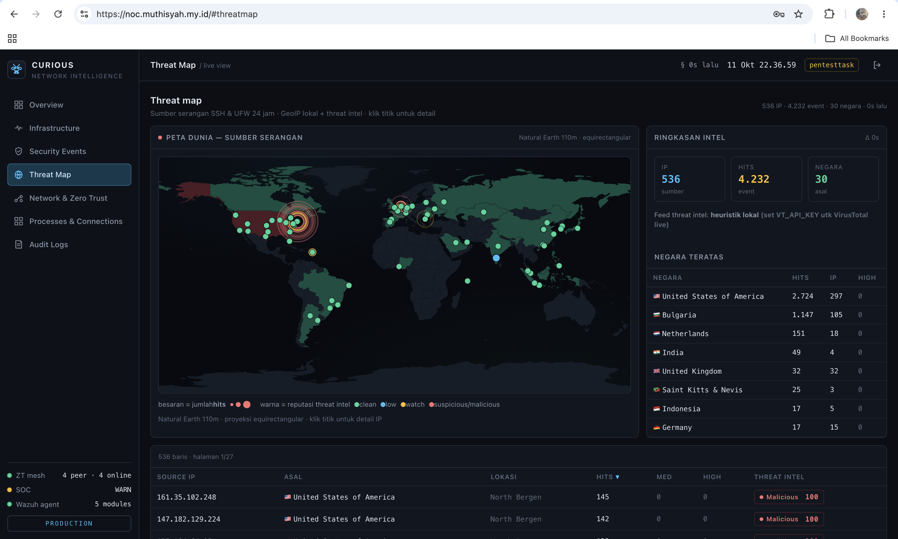
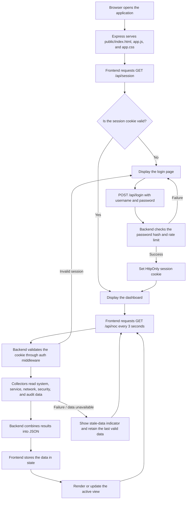

# Project-Noc

Project-Noc is a Security Operations Center (SOC) / Network Operations Center (NOC) dashboard that runs on a local server to monitor infrastructure, system services, network traffic, and security events. Built with Node.js and Express, it displays real-time data collected from common Linux utilities such as `systemctl`, `ss`, `journalctl`, and `df`.

## Key features

- System monitoring: CPU load, memory, disk usage, uptime, and kernel information
- Service status: `systemctl is-active` checks for services such as Nginx, MySQL, PHP-FPM, ZeroTier, Wazuh, and internal services
- HTTP/TCP checks: probes important endpoints and open ports
- Security monitoring: SSH events such as successful and failed logins, invalid users, and brute-force attempts
- Firewall and network security: UFW block history, network connections, socket listeners, and ZeroTier peers
- Audit logs: service start/stop events, sudo activity, and sshd events
- Web dashboard: Overview, Infrastructure, Security Events, Network, Processes, and Audit views
- Authentication: password login with a limit of 5 attempts per 5 minutes

## Application architecture

```text
Project-Noc/
├── data/
│   ├── metrics.json                 # Chart telemetry; created and updated by the application
│   ├── users.json                   # Users, password hashes, and TOTP secrets
│   └── INITIAL_CREDENTIALS.txt      # Bootstrap credentials; created on first run
├── docs/
│   └── screenshots/                 # Dashboard documentation screenshots
├── public/
│   ├── app.css                      # Dashboard styles
│   ├── app.js                       # Data fetching, state, navigation, and UI rendering
│   └── index.html                   # Dashboard page structure and shell
├── .gitignore
├── LICENSE
├── package.json
├── README.md
└── server.js                        # Express backend, authentication, collectors, and API
```

The `data/` directory stores runtime data. `users.json` and `INITIAL_CREDENTIALS.txt` may contain sensitive information; do not upload production data to a public repository. The `docs/screenshots/` directory is intended for dashboard documentation images.

## Screenshots

Interface screenshots are stored in `docs/screenshots/`. The gallery below is arranged from the general overview to more specific operational views:

<table>
  <tr>
    <td width="50%">
      
      <p><strong>Overview</strong><br>Summary of host health, system metrics, services, and security activity.</p>
    </td>
    <td width="50%">
      
      <p><strong>Infrastructure</strong><br>Resource trends, filesystem usage, interface traffic, and service status.</p>
    </td>
  </tr>
  <tr>
    <td width="50%">
      
      <p><strong>Applications and services</strong><br>Service unit statuses monitored in the Infrastructure view.</p>
    </td>
    <td width="50%">
      
      <p><strong>Security Events</strong><br>Summary of SSH events, severity distribution, and Wazuh agent status.</p>
    </td>
  </tr>
  <tr>
    <td width="50%">
      
      <p><strong>Network &amp; Zero Trust</strong><br>ZeroTier topology, peers, and socket listeners categorized by exposure.</p>
    </td>
    <td width="50%">
      
      <p><strong>Processes &amp; Connections</strong><br>TCP/UDP connections with their state, local and remote addresses, and process.</p>
    </td>
  </tr>
  <tr>
    <td width="50%">
      
      <p><strong>Threat Map</strong><br>Map of security event sources and the threat intelligence summary shown in the screenshot.</p>
    </td>
    <td width="50%">
      
      <p><strong>Audit Logs</strong><br>sudo activity, systemd service changes, and sshd lifecycle events.</p>
    </td>
  </tr>
</table>

## Backend and display flow

The following diagram summarizes how data flows from the browser to the server and back to the dashboard:



Process details:

1. Express serves static files from `public/`.
2. On initialization, the frontend checks the session through `GET /api/session`. If the user is not authenticated, the login page is displayed.
3. The frontend sends the username and password to `POST /api/login`. If they are valid, the backend sends a session cookie. Failed attempts are limited to 5 before the IP address is locked for 5 minutes.
4. After login, the frontend immediately calls `GET /api/noc` and then repeats the request every 3 seconds. This endpoint is protected by authentication middleware.
5. The backend collects data from the operating system and configured services, reads historical telemetry, calculates health status, and returns a single JSON response.
6. The frontend stores the response in state, updates the header indicators, and selects a renderer for the active view: Overview, Infrastructure, Security Events, Network, Processes, or Audit.
7. If data retrieval fails, the dashboard keeps the last valid data and displays a stale-feed indicator. If the server responds with `401`, the frontend returns to the login page.

> Implementation note: the backend provides a `POST /api/2fa/verify` endpoint, but the current frontend login flow only calls `POST /api/login`; the UI does not request or submit a TOTP code.

## Requirements

- Node.js LTS (version 18 or later recommended)
- A Linux system with the following utilities:
  - `systemctl`
  - `curl`
  - `ss`
  - `journalctl`
  - `df`
  - `nproc`
  - `uname`
  - `cat /proc/...`
- Root access, or at least sufficient access to the services and system logs being monitored

## Installation

1. Clone the repository:

   ```bash
   git clone https://github.com/muathoillah/Project-Noc.git
   cd Project-Noc
   ```

2. Install dependencies:

   ```bash
   npm install
   ```

3. Start the application:

   ```bash
   node server.js
   ```

4. The application will be available at:

   ```text
   http://127.0.0.1:4000
   ```

## Environment configuration

The application supports the following environment variables:

```bash
export PORT=4000
export NOC_USER=admin
export NOC_PASSWORD=StrongPassword123
export NOC_SESSION_KEY=custom-session-key
node server.js
```

Notes:
- If `NOC_USER` and `NOC_PASSWORD` are not set, the application automatically creates an admin user with a random password.
- The initial password is printed to the terminal and saved in `data/INITIAL_CREDENTIALS.txt`.
- `NOC_SESSION_KEY` is used to sign the session cookie.

## Login and authentication

On first run, if no users exist, the application creates an admin user and a new TOTP secret. Bootstrap details are written to the terminal and to `data/INITIAL_CREDENTIALS.txt`.

Example credentials file:

```text
SOC / NOC Dashboard - initial credentials
URL      : https://noc.muthisyah.my.id
Username : admin
Password : <random-password>
Secret   : <totp-secret>
```

The current UI login flow uses a username and password. The backend also has a TOTP verification endpoint, but it is not connected to the frontend login form. The application applies rate limiting:

- A maximum of 5 login attempts per IP address
- A 5-minute lockout after the limit is exceeded

## Main API endpoints

`GET /api/session`, `POST /api/login`, and `POST /api/2fa/verify` do not require an existing session cookie. `POST /api/logout` and `GET /api/noc` do require session-cookie authentication.

### `GET /api/session`
Returns the current session authentication status.

### `POST /api/login`
Authenticates with a username and password.

Request body:

```json
{
  "username": "admin",
  "password": "your-password"
}
```

### `POST /api/2fa/verify`
Backend endpoint for verifying a TOTP code. This endpoint is available on the server but is not currently called by the UI.

Request body:

```json
{
  "username": "admin",
  "password": "your-password",
  "code": "123456"
}
```

### `POST /api/logout`
Logs out the current user.

### `GET /api/noc`
Returns a dashboard payload containing:

- `system`
- `disk`
- `net`
- `services`
- `security`
- `network`
- `processes`
- `audit`
- `metrics`
- `health`

## Data files

### `data/users.json`
Contains registered users, password hashes, salts, TOTP secrets, and the `totpVerified` flag.

### `data/metrics.json`
Stores a series of historical metrics, such as:

```json
[
  {
    "ts": 1730000000000,
    "load1": 0.82,
    "memUsedPct": 48,
    "diskUsedPct": 35,
    "rx": 1.6,
    "tx": 0.9
  }
]
```

### `data/INITIAL_CREDENTIALS.txt`
This file contains the initial credentials created automatically when no users exist. It can be used during server bootstrapping when interactive access is unavailable.

## Dashboard views

### Overview
Displays a summary of health, uptime, server status, and system condition indicators.

### Infrastructure
Displays:
- CPU, memory, and swap status
- Disk usage by mount point
- Service health
- HTTP/TCP probes

### Security Events
Displays SSH logs and security indicators such as:
- Accepted logins
- Failed passwords
- Invalid users
- Maximum authentication attempts

### Network & Zero Trust
Displays:
- Network interface traffic
- ZeroTier peer status
- TCP/UDP listeners
- Network and peer information

### Processes & Connections
Displays active connections, open ports, and user/process mappings for sockets.

### Audit Logs
Displays logs from:
- `sudo`
- `systemd`
- `sshd`

## Security notes

- The application binds to `127.0.0.1` by default rather than listening on all interfaces.
- The session cookie uses `HttpOnly`, `Secure`, and `SameSite=Strict`.
- Passwords are stored as `scrypt` hashes with a unique salt for each user.
- TOTP secrets are stored in `data/users.json`; protect this file with `0600` permissions.
- Do not commit `data/users.json` or `data/INITIAL_CREDENTIALS.txt` to a public repository if they contain production credentials.

## Troubleshooting

### Unable to log in
- Make sure `users.json` exists in the `data/` directory.
- Check whether `INITIAL_CREDENTIALS.txt` contains the initial password.
- Keep `NOC_SESSION_KEY` consistent between sessions if you want session cookies to remain valid.

### The `/api/noc` endpoint is empty or returns an error
- Make sure the monitored system has utilities such as `systemctl`, `ss`, `journalctl`, and `curl`.
- Make sure services such as `sshd`, `nginx`, or other services being monitored are available.
- Check the application terminal output for a stack trace.

### `Cannot find module` or dependency errors

```bash
npm install
```

### The server cannot be opened in a browser
- Make sure port `4000` is not being used by another process.
- Run `node server.js` in a terminal that remains open.
- Check `http://127.0.0.1:4000/api/session` in a browser or with `curl`.

```bash
curl -i http://127.0.0.1:4000/api/session
```

## Roadmap

- Add Swagger/OpenAPI documentation
- Add role-based access control (RBAC)
- Add PDF/CSV log export
- Add alert notifications via email, Telegram, or Slack
- Add dashboard user management
- Add caching and query optimizations for larger data sets

## License

This project is licensed under the ISC License, as specified in the `LICENSE` file.

## Note

This document is intended for operational and internal documentation. For further development, consider adding a separate production environment and disabling debug features in public deployments.
